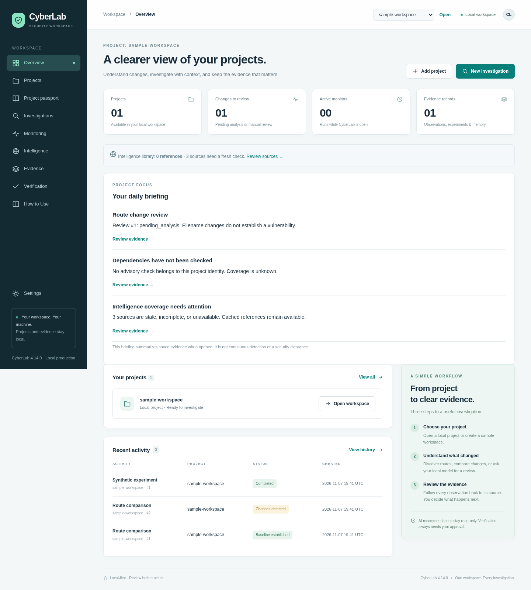

# CyberLab

One local security workspace for project investigations, current public threat
references, monitoring, controlled verification, and evidence.

**Current release: 4.14.0.** Project passports, evidence-linked daily briefings,
lockfile dependency checks, and isolated CVE retries.

**[How to Use — plain-language, step-by-step guide](HOW_TO_USE.md)** ·
[Printable PDF guide](docs/CyberLab-How-To-Use.pdf) · [Production operations](PRODUCTION.md) · [Validation results](TEST_RESULTS.md)



[Download the current program](https://github.com/emergingtechnologyllc-arch/CyberLab_AI/raw/refs/heads/main/cyberlab-ai.zip)

## Install the local production profile

Python 3.10+ and Bash are required (Ubuntu 22.04+). Extract the ZIP to a fresh
folder, open a terminal inside its `cyberlab-ai` directory, and run:

```bash
python3 scripts/install_production.py
```

The installer creates a private persistent runtime, verifies and installs the
bundled Waitress dependency offline, backs up an existing database, and runs
isolated smoke checks before activating the release. It prints a stable launch
command; normally:

```bash
"$HOME/.local/share/cyberlab/start.sh"
```

Open `http://127.0.0.1:8780`. Stop any earlier manual instance first. This is a
single-user **local production profile**, not a public multi-user web service.
The loopback bind and explicit authorization for active checks remain mandatory.

On Ubuntu, install `python3-venv` if virtual-environment creation is unavailable.
No sudo is needed for the CyberLab installer itself. The verified production wheel
is bundled, so pip does not fetch dependencies from the Internet during deployment.
Ollama is optional and is not downloaded or started by this installer.

To retain a custom existing workspace:

```bash
python3 scripts/install_production.py \
  --data-dir /your/existing/data \
  --projects-dir /your/existing/projects
```

Subsequent installs preserve saved paths unless explicitly changed. Defaults remain
`~/.cyberlab-v4` and `~/CyberLab-Projects`. Prior installations, evidence and code
releases are preserved. See the guide for the earlier temporary-workspace example,
backup paths, rollback and troubleshooting.

### Optional automatic startup

```bash
python3 scripts/install_production.py --enable-service
```

This installs a systemd **user** service only when explicitly requested. It checks
for a user manager, refuses unrelated unit files/port occupants, and provides status
commands. Login/logout persistence depends on the host's user-manager settings.
Unit syntax was verified in the cloud; real Ubuntu service operation is a separate
acceptance check.

## What is new in 4.14

Choose an active project, then open **Project passport** to describe its owner,
purpose, environment, sensitivity and expected access. These are human declarations.
**Overview** shows a daily briefing from saved evidence with links to the underlying
checks. Unknown or stale coverage is shown explicitly. Opening the briefing does
not run a scan, and a zero-match check is not a clean bill of health.

**Intelligence → Check project advisories** prefers `npm-shrinkwrap.json`, then
`package-lock.json` (versions 1–3). Multiple versions and transitive packages remain
separate. Check details display queried/total component counts and consistency notes.
Up to 3,000 lock entries are inventoried; a check queries at most 1,000 unique pairs,
in direct-first order. The first 100 components are shown in the detail page.
The deployed installation, source reachability and actual exploitability remain unverified.

Each project has an identity bound to its canonical folder. Preserve your configured
project path during upgrades. Moving or renaming a folder creates another identity;
name-only legacy records stay visible in all-workspace history but are excluded from
project correlations. Historical records with explicit roots are migrated safely.

A failed CVE download now retries after 5 and 10 minutes, then is quarantined after
three failures. Other records continue. **Retry failed CVE records** resets failed
records; a newer publisher revision also reopens a quarantined record. Incomplete
feeds are labeled explicitly. This remains a recent-window cache, not a full CVE mirror.

## What “learning” means

CyberLab maintains a timestamped, searchable local reference library:

- **CISA KEV**: known exploited vulnerabilities, refreshed hourly by default.
- **CVE Program**: recent publisher delta windows, checked every five minutes;
  observed records are queued and processed in bounded batches.
- **MITRE ATT&CK**: the enterprise technique catalog, refreshed daily.
- **OSV**: explicit project checks of npm lockfile versions, with a manifest fallback.

Sources have saved refresh preferences, cached records, source/fetch dates,
content revisions, failure states and a bounded audit history. Good cached data
survives failed refreshes. Public downloads use fixed official publisher URLs and
verified TLS; the app does not fetch arbitrary advisory links or exploit code.

This is **reference refresh and retrieval, not model retraining**. Bounded related
CVE context can reach Ollama only through root-proven project advisory aliases.
No source/model text confirms project exploitability or authorizes a test.

CVE coverage is explicitly limited to observed publisher windows, not the whole
historical CVE database. An offline gap can miss changes. ATT&CK describes attack
methods; it is not a live incident feed for your computer. NVD ingestion is not
implemented in this release. See THIRD_PARTY.md for publisher attribution and terms.

## Layout, explained simply

- **Overview** — the front cover: projects, activity and cached-library status.
- **Projects** — the filing cabinet: authorized local application folders.
- **Investigations** — the flashlight: route discovery, comparisons and local AI review.
- **Monitoring** — the reminder clock: scheduled route inventory checks.
- **Intelligence** — the reference library: refresh/search bulletins and check dependencies.
- **Evidence** — the notebook: original observations, risk reviews and memory snapshots.
- **Verification** — the test bench: only separately approved synthetic/local checks.
- **How to Use** — the complete operator guide inside the application, with download.
- **Settings** — storage, release, local model and connection information.

Choose a project in the top bar and retain that context as you navigate. Samples
are optional and clearly synthetic; production installation does not create fake
projects, evidence or findings. Current route tools support Next.js filenames and
package checking supports npm manifests and lockfile versions 1–3; this is not a universal source-code scanner.

## Operational controls

Waitress replaces the development HTTP transport. The application has request/body
limits, a deduplicated bounded background queue, a per-data-directory instance lock,
private file permissions, SQLite WAL, consistent backups and graceful shutdown.
`/healthz` checks runtime/database readiness; it does not certify model/feed health.

Automatic public-source refresh is enabled by default while the installed app is
running. Disable globally with the installer's `--no-auto-intelligence`, or pause
individual sources in Intelligence. Project monitoring, scheduled AI analysis and
active verification each retain their separate controls and consent.

## Development and release checks

From the source checkout, prepare the same verified runtime:

```bash
python3 -m venv .venv
.venv/bin/python -m pip install --no-index --find-links vendor --require-hashes -r requirements.txt
.venv/bin/python -m unittest discover -s tests -v
.venv/bin/python scripts/smoke_test.py
bash ./start.sh
```

The compatibility command `bash ./start-cyberlab-v4.sh` launches the same program.
Public-network checks are deliberately separate from isolated offline tests:

```bash
.venv/bin/python scripts/refresh_intelligence.py --data-dir /your/data --status
.venv/bin/python scripts/refresh_intelligence.py --data-dir /your/data
.venv/bin/python scripts/smoke_test.py --live-ollama
```

Optional development browser/PDF tools require Playwright and Chromium; they are
not application runtime dependencies:

```bash
python3 scripts/browser_check.py --screenshots /tmp/cyberlab-ui-review
python3 scripts/build_guide_pdf.py --url http://127.0.0.1:8780/help
```

`cyberlab/__init__.py` remains the authoritative application version. Update it and
CHANGELOG.md for releases. Do not create parallel version-specific source folders.
`python3 scripts/package_release.py` deterministically builds the single current
`cyberlab-ai.zip` from a shared allowlist, including the production wheel and guides,
while excluding credentials, databases, virtual environments and historical releases.
Always test a fresh extraction and installer before publication.

## Limits

Route discovery reads filenames, not source contents or authorization logic.
Models return unverified hypotheses. Verification remains bounded to authorized
synthetic/offline or loopback cases; no arbitrary shell tools, remote exploitation,
automatic patching, or automatic merging are implemented. A status mismatch alone
is not a confirmed vulnerability.

Legacy unknown-root evidence remains viewable but is excluded from new root-scoped
model context. Preserve configured data/projects paths across upgrades. User-service,
Ubuntu and real Ollama results must be verified on the target host; do not confuse
cloud Debian/mocked checks with those integrations. Production here describes an
implemented local runtime/deployment profile, not a security certification or
complete detection/coverage guarantee.
